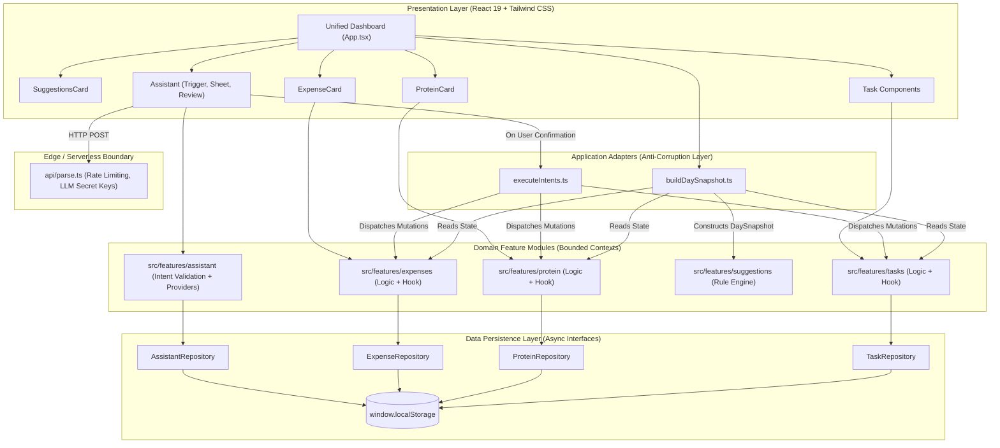

# Campus Compass

> A context-aware daily planner for college students that unifies study blocks, gym habits, protein targets, and student budgets into a single prioritized **Today** view.
>
> **Live Demo:** [Demo Link Placeholder: Coming Soon](https://campus-compass.example.com)

---

<!-- Screenshot Placeholders -->
<div align="center">
  <p><em>Desktop and Mobile Dashboard Preview</em></p>
  
</div>

<br />

<div align="center" style="display: flex; gap: 10px; justify-content: center;">
  
  
</div>

---

## The Problem

College students juggle academic deadlines, fitness routines, daily nutrition, and living expenses across four or five separate, disconnected applications every single day. Because these tools operate in isolated silos, none of them understand real student trade-offs: a task manager will not tell you to defer dorm chores when midterms arrive, and a calorie counter has no awareness of an impending exam or a depleted monthly grocery budget. The result is constant context-switching, cognitive fatigue, and fragmented daily planning that introduces friction rather than clarity.

---

## Core Features

- **Prioritized Today Agenda and Habit Streaks:**
  Unified scheduling for study blocks, workouts, skincare, and chores. Non-recurring tasks support overdue resurfacing so past incomplete work is never lost; recurring tasks (daily/weekly) calculate dynamic habit streaks from date logs (`completedDates`) without resetting mid-day.
- **Daily Protein Tracker:**
  Calculates target protein intake from body weight (`weightKg * 1.6`) with custom override support. Features a 3-option diet preference control (Veg / Eggetarian / Non-veg) with 4px radius, live preset filtering (`presetsForDiet`), 8 tagged student presets (egg, paneer, dal, whey, chicken, milk, 100g Soya chunks (dry), curd), unfiltered custom entry logging, and visual progress tracking.
- **Monthly Student Expense Tracker:**
  Tracks spending across essentials (Food, Travel, Rent, Subscriptions, Study, Other) against overall and per-category monthly budgets. Includes month-by-month historical navigation, float-safe rupee input parsing, and automated threshold alerts at $\ge 80\%$ budget usage.
- **Rule-Based Contextual Suggestion Engine:**
  Evaluates real-time student trade-offs across all three modules to surface at most 3 actionable, explainable planning nudges sorted by severity (`warning` > `nudge` > `info`). Dietary preferences are respected: vegetarian users are never told to eat eggs or chicken.
- **Conversational Planning Assistant ("Nova"):**
  Hands-free, multi-intent voice or text capture (e.g. *"hey Nova, submit DBMS assignment tomorrow, spent 120 on lunch, had 2 eggs"*). Uses browser `SpeechRecognition` (`en-IN` default), serverless edge parsing via Google's Gemini API (configurable model, default `gemini-3.8-flash`), prompt-injection defense, and a mandatory confirmation queue with inline item editing before saving. Optional speech synthesis (`SpeechSynthesis`) reads out confirmations and questions.

---

## How Suggestions Work

Campus Compass uses a **deterministic, rule-based heuristics engine** rather than an unpredictable, non-deterministic LLM. Every rule is a pure function that evaluates an immutable daily snapshot of facts and outputs an explicit `reason` referencing the exact numerical data that triggered it. Suggestions are planning nudges: never medical, dietary, or financial advice.

### Example Rules in Action

1. **Deadline Pressure (`warning`):**
   - *Trigger:* A priority-1 study task is due within 2 days ($\le 2$ days away).
   - *Reason Output:* `"A priority-1 study task is due tomorrow (1 days away)."`
   - *Action Nudge:* `"Focus on your study blocks and consider deferring chores and skincare to later."`
2. **Evening Protein Catch-Up under Budget Constraint (`nudge`):**
   - *Trigger:* Time is past 6 PM (`hour >= 18`), total protein is $< 60\%$ of goal, and food budget is $\ge 80\%$ used.
   - *Reason Output:* `"Protein is 45g of 112g (40%) and it is 19:00 (after 6 PM)."`
   - *Action Nudge (Diet-Aware):* Adapts to the user's diet preference. For vegetarian users: `"Close the 67g gap with budget-friendly staples like curd, dal, or soya chunks."` (never eggs or chicken). For eggetarian users: includes boiled eggs. For non-vegetarian users: includes standard student staples.

---

## Architecture and Dependency Direction

The application follows **Domain-Driven Design (Bounded Contexts)** and the **Dependency Inversion Principle (DIP)**:



### Dependency Direction (Hexagonal / Clean Architecture)
The domain feature modules (`tasks`, `protein`, `expenses`, `assistant`) are isolated bounded contexts with **zero cross-dependencies** on each other. The suggestion engine (`src/features/suggestions`) does not import or know about tasks, protein, or expense domain models; it depends solely on an abstract input contract (`DaySnapshot`) consisting of plain primitive values mapped by `src/app/buildDaySnapshot.ts`. Similarly, the assistant module (`src/features/assistant`) defines its own plain discriminated union intent types and is completely unaware of domain repositories; the second application adapter, `src/app/executeIntents.ts`, is the sole bridge mapping confirmed intents to domain operations upon explicit user confirmation. All data access is mediated through abstract, asynchronous repository interfaces returning `Promise<T>`. This architecture ensures that replacing `localStorage` with a remote backend, swapping the LLM provider, or adding new suggestion rules causes zero cascading changes across the codebase.

---

## Design System and UI Architecture

Campus Compass features a custom, atomic design system crafted for a calm, high-focus productivity experience inspired by Linear, Notion Calendar, and Apple Fitness. It is fully mobile-first and scales seamlessly into a desktop two-column bento dashboard (`lg:grid-cols-12`).

### 1. Design Tokens (Tailwind CSS v4)
- **Primary Accent:** Indigo (`--color-primary-50` through `--color-primary-900`, anchor `#6366f1` / `#4f46e5`).
- **Neutral Grayscale:** Slate (`slate-50` through `slate-950`) providing high contrast and low eye fatigue in both modes.
- **Semantic Colors:**
  - Success: `emerald-500` / `emerald-600` (task completion, on-track progress)
  - Warning: `amber-500` / `amber-600` (budget warnings $\ge 80\%$, planning nudges)
  - Danger: `rose-500` / `rose-600` (overdue tasks, budget deficits, critical deadline pressure)
  - Modules: `indigo-500` (rent), `sky-500` (travel), `amber-500` (food/nutrition)
- **Typography:** `Inter` variable font with strict typographic hierarchy and tabular numerals (`.tabular-nums`) for currency and numerical metrics.
- **Spacing Scale:** Standard 4px / 8px grid (`gap-1.5`, `gap-2`, `gap-3`, `gap-4`, `p-4`, `p-5`).
- **Radius Scale:** Soft modern corners (`rounded-xl` 12px, `rounded-2xl` 16px, `rounded-3xl` 24px) for cards, and 4px for controls.
- **Shadow Scale:** Layered soft ambient shadows (`shadow-2xs`, `shadow-xs`, `shadow-sm`, `shadow-md`).
- **Theme Provider:** Instant dark/light mode toggle supporting system preferences (`prefers-color-scheme`) and manual selection with persistent local caching and zero-flash loading.
- **Accessibility and Motion:**
  - Strict **44px minimum touch targets** on all mobile controls, chips, and icon triggers (using `min-h-[44px]` or pseudo-element hit-target expansions).
  - WCAG AA compliant text contrast in both light and dark modes.
  - Keyboard focus rings (`focus:ring-2 focus:ring-indigo-500`).
  - Full `prefers-reduced-motion` compliance resetting transitions and animations for motion-sensitive users.

### 2. Reusable Component Library (`src/components/`)
All screens and feature modules are built using atomic, decoupled UI components:
| Component | Path | Description and Capabilities |
| :--- | :--- | :--- |
| **`Card`** | `src/components/Card.tsx` | Base container surface with rounded-2xl border, soft shadow, and dark mode background tokens. |
| **`Button`** | `src/components/Button.tsx` | Accessible button with `primary`, `secondary`, `ghost`, and `danger` variants; supports sizes, loading states, and minimum 44px hit-target. |
| **`IconButton`** | `src/components/IconButton.tsx` | Icon-only button with mandatory `aria-label`, 44px touch target padding, and hover/focus rings. |
| **`Badge`** | `src/components/Badge.tsx` | Status and category indicators (`indigo`, `emerald`, `amber`, `rose`, `slate`). |
| **`Chip`** | `src/components/Chip.tsx` | Interactive filter pill with active/inactive states and badge counter support. |
| **`ProgressBar`** | `src/components/ProgressBar.tsx` | Animated horizontal progress bar with semantic color variants. |
| **`ProgressRing`** | `src/components/ProgressRing.tsx` | SVG circular progress ring with stroke-dashoffset animation and centered custom content. |
| **`Modal`** | `src/components/Modal.tsx` | Accessible dialog modal with keyboard `Escape` handler, focus trapping, and backdrop blur. |
| **`EmptyState`** | `src/components/EmptyState.tsx` | Clean empty state view with icon, title, description, and optional action trigger. |
| **`AppHeader`** | `src/components/AppHeader.tsx` | Dynamic greeting, calendar date, and theme toggle. |
| **`BottomNav`** | `src/components/BottomNav.tsx` | Mobile-first 4-tab bottom navigation bar with active indicators and 44px touch targets. |

---

## Key Engineering Decisions

| Decision | Why It Matters / Interview Defense |
| :--- | :--- |
| **Diet Preference Segmentation & Unfiltered Logging** | Dietary preference (`veg`, `egg`, `non-veg`) filters quick-add presets and tailors suggestion engine recommendations so vegetarian users never see prompts for eggs or meat. However, manual and conversational logging remains completely unconstrained: if a vegetarian user logs eggs, the system faithfully records the entry without blocking or judging. The assistant receives the diet preference in context to avoid recommending non-veg alternatives. |
| **The Trust Boundary (Model Output as Untrusted Input)** | Natural language model outputs are non-deterministic and susceptible to prompt injection, hallucinated schema parameters, and malformed structures. In Campus Compass, LLM responses are treated as untrusted external payloads. The `validateIntents` gate enforces strict schema conformance, strips malicious script tags and injection payloads, drops unrecognized intent types (such as unauthorized deletion or modification attempts), bounds multi-intent bursts to 5, and validates calendar dates against real Gregorian calendar boundaries (e.g. rejecting `2026-02-30`). |
| **Mandatory Human-in-the-Loop Confirmation** | Autonomous agents that directly commit mutations to databases create phantom records, double-counting, and user distress. In Campus Compass, the assistant only parses utterances into a staged confirmation queue. Users retain full autonomy to inspect, edit fields inline (adjusting titles, categories, priorities, due dates, paise amounts, or protein grams), and discard false positives before a single database write is executed via "Confirm all". |
| **Server-Side Secret Isolation & Edge Rate Limiting** | Storing LLM API keys in client applications exposes credentials to reverse-engineering, quota hijacking, and financial liability. The conversational assistant connects through a serverless function (`/api/parse`) running at the edge. The serverless handler sends API credentials strictly via the `x-goog-api-key` header rather than URL query parameters to avoid logging secrets, and handles 404 model unavailability gracefully. The handler enforces strict payload constraints (<10KB body, <1,000 character transcripts) and sliding-window IP rate limiting (max 30 req/min), falling back to deterministic local heuristic extraction if remote APIs are unavailable. |
| **Decoupled LLMProvider Interface** | Client modules and UI components never bind directly to a specific LLM vendor SDK. The `LLMProvider` contract requires only `parse(transcript, context): Promise<unknown>`. Production uses `FetchLLMProvider` calling `/api/parse`, while tests and offline environments use `MockLLMProvider`. Providers can be swapped to an alternate backend or on-device local model without altering a single line of business logic or UI code. |
| **Integer Paise for Money** | In IEEE 754 floating-point arithmetic, binary floating-point fractions cannot represent decimal fractions precisely (e.g. `0.1 + 0.2 === 0.30000000000000004`). In financial apps, float arithmetic produces cumulative rounding errors and off-by-one paise discrepancies. All money is stored and calculated strictly as **integer paise** ($1\text{ INR} = 100\text{ paise}$). Currency conversion from rupee strings (e.g. `"12.5"`) directly into `1250` paise is performed via string splitting and padding without `parseFloat`. INR formatting (`Intl.NumberFormat`) happens strictly at the display boundary. |
| **Local Date Strings & Injected "Today"** | `date.toISOString().split('T')[0]` converts local time to UTC (GMT+0). For students in non-UTC timezones (e.g. IST UTC+5:30 or PST UTC-8:00) using the app late in the evening, UTC shifts to tomorrow or yesterday, causing tasks to vanish or falsely appear overdue. All dates are formatted using local calendar getters (`formatLocalDate`). Pure functions take `today: string` and `hour: number` as explicit parameters and **never call `new Date()` internally**, making tests 100% deterministic. |
| **Async Repository Pattern** | UI components and hooks depend strictly on abstract repository interfaces (`TaskRepository`, `ProteinRepository`, `ExpenseRepository`, `AssistantRepository`) returning `Promise<T>`. While implemented with `window.localStorage` for local-first zero-config development, swapping to Supabase, SQLite, or an offline sync engine requires writing repository adapters complying with the same interface, with zero edits to UI components or hooks. |
| **Pure-Function Business Logic** | All filtering, sorting, recurrence, streaks, weekly summaries, budget totals, suggestion rules, and intent validation gates are pure functions isolated from React lifecycle and DOM APIs. They execute in memory in <500ms across 129 unit tests without requiring DOM mocking libraries or test flakiness. |

---

## Comparison with Existing Tools

| Tool | What It Does Well | Where It Falls Short for Students | How Campus Compass Differs |
| :--- | :--- | :--- | :--- |
| **Notion** | Unmatched customization, markdown editing, and database relation flexibility. | High setup fatigue; lacks built-in habit streak logic, local-time timezone protections, or cross-domain trade-off nudges. | Pre-configured, zero-setup mobile planner with deterministic, automated cross-domain rules. |
| **TickTick** | Robust task scheduling, recurring reminders, and integrated calendar views. | Completely blind to nutrition and personal finances; cannot advise deferring chores when budget or diet requires attention. | Treats tasks, physical nutrition, and student living expenses as mutually influencing factors in one view. |
| **MyFitnessPal** | Massive verified food database, barcode scanning, and detailed micronutrient tracking. | Bloated calorie-centric interface with intrusive subscription prompts and no connection to daily academic or financial life. | Lightweight, privacy-first protein tracking with fast student presets and context-aware grocery budget alerts. |
| **Splitwise** | Excellent shared group expense splitting and IOUs among college roommates. | Focused strictly on shared balances; does not track personal category budgets or prompt lifestyle trade-offs. | Focuses on personal monthly budget adherence with integer-exact arithmetic and threshold alerts. |

---

## Testing and Verification

The codebase includes **147 unit tests** powered by **Vitest**, covering domain logic, boundary conditions, input parsers, intent safety gates, and repository adapters:

```bash
# Run the complete unit test suite
npm run test

# Run tests in watch mode for development
npm run test:watch
```

### Test Coverage Highlights:
- **Tasks Logic (28 tests):** Daily recurrence across days (resets cleanly), weekly recurrence weekday matching, overdue task retention, priority sorting hierarchy with completed tasks anchored last, category filtering, weekly summary aggregation, habit streak computation (active, pending, broken, restart).
- **Protein Logic (21 tests):** Body weight multiplier ($1.6\times$), daily summation, remaining protein calculation (floored at 0), display percentage capping at 100%, chronological sorting, settings input validation, diet preference preset filtering (`presetsForDiet`).
- **Expenses Logic (15 tests):** Float-safe string-to-paise parser (`"12.5"` $\to$ 1250, `"100"` $\to$ 10000, `"0.75"` $\to$ 75), INR formatting, monthly totals, category totals, remaining budget, uncapped budget percentages, budget status transitions (ok, warning $\ge 80\%$, over $> 100\%$), category warning detection.
- **Suggestion Engine and Rules (29 tests):** Diet-specific food recommendations for veg, egg, and non-veg, numerical boundaries (hour 17 vs 18, 59% vs 60%, 79% vs 80%, 2 vs 3 overdue tasks, 4 vs 5 study completions), severity ranking order (`warning` $>$ `nudge` $>$ `info`), max-3 capping, and empty state output.
- **Assistant Intent Validation and Injection Defense (22 tests):** Wake word stripping (`hey Nova`), discriminated union intent parsing (`add_task`, `add_expense`, `add_protein`, `clarify`), prompt-injection sanitization, malformed JSON protection, dropping unauthorized intent types, real Gregorian calendar date validation, preserving explicit user entries regardless of diet, and the 5-intent burst cap.
- **LLM Providers (6 tests):** `FetchLLMProvider` HTTP dispatch, context forwarding, and friendly model-unavailable (404) error handling; `MockLLMProvider` canned and custom parser behavior.
- **Storage Repositories (17 tests):** Seed data loading, async CRUD operations for Task, Protein, Expense, and Assistant Settings LocalStorage adapters, plus backward-compatible migration defaulting old storage without dietPreference to veg.
- **Date Utilities (5 tests):** Deterministic short date formatting (`formatShortDate`), local date formatting, and week range calculation.
- **Serverless Parser Endpoint (1 test):** Safe model-unavailable 404 response and non-sensitive error logging for Google's Gemini API.
- **Anti-Corruption and Execution Adapters (3 tests):** `buildDaySnapshot` end-to-end integration and `executeIntents` mapping from assistant intents to domain DTOs without side effects.

---

## Known Limitations and Roadmap

- **Proxy for Deadline Pressure:** The app currently lacks university LMS (Canvas/Blackboard) or sleep tracker integrations; high-priority study tasks (`priority === 1`) due within 2 days serve as a heuristic proxy for academic crunch periods.
- **Local-First Persistence:** Data is stored in the browser's `localStorage`. Clearing browser cache resets data to seed state. A Supabase backend adapter with PostgreSQL and Auth is architecturally pre-wired via the repository pattern.
- **Session-Only Suggestion Dismissals:** Suggestion dismiss state is stored in React component state (`dismissedIds`) for the duration of the browser session and is not persisted to storage, preventing ephemeral UI state from cluttering domain models.
- **Roadmap:**
  - Supabase database repository adapter with Google OAuth authentication.
  - Receipt image scanning with OCR for automated expense entry.
  - University calendar sync (iCal integration).

---

## Local Setup and Installation

### Prerequisites
- Node.js `v18.0.0` or higher
- npm `v9.0.0` or higher

```bash
# 1. Clone the repository
git clone https://github.com/nitinbhhardwaj/campus-compass.git
cd campus-compass

# 2. Install dependencies
npm install

# 3. Run all unit tests
npm run test

# 4. Start local development server
npm run dev
# -> Open http://localhost:5173

# 5. Build for production (TypeScript compile + Vite bundle)
npm run build
```

---

## License

This project is licensed under the MIT License: see the [LICENSE](LICENSE) file for details.
