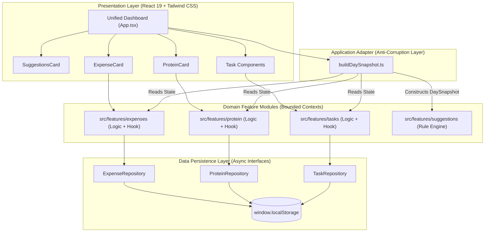

# Campus Compass

> A context-aware daily planner for college students that unifies study blocks, gym habits, protein targets, and student budgets into a single prioritized **Today** view.
>
> 🔗 **Live Demo:** [Demo Link Placeholder — Coming Soon](https://campus-compass.example.com)

---

<!-- Screenshot Placeholders -->
<div align="center">
  <p><em>Desktop & Mobile Dashboard Preview</em></p>
  <!-- Replace with actual screenshots:  -->
  
</div>

<br />

<div align="center" style="display: flex; gap: 10px; justify-content: center;">
  <!-- Replace with mobile views:   -->
  
  
</div>

---

## 🎯 The Problem

College students juggle academic deadlines, fitness routines, daily nutrition, and living expenses across four or five separate, disconnected applications every single day. Because these tools operate in isolated silos, none of them understand real student trade-offs—a task manager will not tell you to defer dorm chores when midterms arrive, and a calorie counter has no awareness of an impending exam or a depleted monthly grocery budget. The result is constant context-switching, cognitive fatigue, and fragmented daily planning that introduces friction rather than clarity.

---

## ⚡ Core Features

- **Prioritized Today Agenda & Habit Streaks:**
  Unified scheduling for study blocks, workouts, skincare, and chores. Non-recurring tasks support overdue resurfacing so past incomplete work is never lost; recurring tasks (daily/weekly) calculate dynamic habit streaks from date logs (`completedDates`) without resetting mid-day.
- **Daily Protein Tracker:**
  Calculates target protein intake from body weight (`weightKg * 1.6`) with custom override support. Features 8 quick-add student presets (eggs, paneer, dal, whey, chicken, milk, soya chunks, curd) marked with approximate gram values, custom entry logging, and visual progress tracking.
- **Monthly Student Expense Tracker:**
  Tracks spending across essentials (Food, Travel, Rent, Subscriptions, Study, Other) against overall and per-category monthly budgets. Includes month-by-month historical navigation, float-safe rupee input parsing, and automated threshold alerts at $\ge 80\%$ budget usage.
- **Rule-Based Contextual Suggestion Engine:**
  Evaluates real-time student trade-offs across all three modules to surface at most 3 actionable, explainable planning nudges sorted by severity (`warning` > `nudge` > `info`).

---

## 🧠 How Suggestions Work

Campus Compass uses a **deterministic, rule-based heuristics engine** rather than an unpredictable, non-deterministic LLM. Every rule is a pure function that evaluates an immutable daily snapshot of facts and outputs an explicit `reason` referencing the exact numerical data that triggered it. Suggestions are planning nudges—never medical, dietary, or financial advice.

### Example Rules in Action

1. **Deadline Pressure (`warning`):**
   - *Trigger:* A priority-1 study task is due within 2 days ($\le 2$ days away).
   - *Reason Output:* `"A priority-1 study task is due tomorrow (1 days away)."`
   - *Action Nudge:* `"Focus on your study blocks and consider deferring chores and skincare to later."`
2. **Evening Protein Catch-Up under Budget Constraint (`nudge`):**
   - *Trigger:* Time is past 6 PM (`hour >= 18`), total protein is $< 60\%$ of goal, and food budget is $\ge 80\%$ used.
   - *Reason Output:* `"Protein is 45g of 112g (40%) and it is 19:00 (after 6 PM)."`
   - *Action Nudge:* `"Close the 67g gap with budget-friendly staples like boiled eggs, curd, dal, or soya chunks."`

---

## 🏛️ Architecture & Dependency Direction

The application follows **Domain-Driven Design (Bounded Contexts)** and the **Dependency Inversion Principle (DIP)**:



### Dependency Direction (Hexagonal / Clean Architecture)
The three primary feature modules (`tasks`, `protein`, `expenses`) are isolated bounded contexts with **zero cross-dependencies** on each other. The suggestion engine (`src/features/suggestions`) does not import or know about tasks, protein, or expense domain models; it depends solely on an abstract input contract (`DaySnapshot`) consisting of plain primitive values. A single application adapter, `src/app/buildDaySnapshot.ts`, is the sole integration point that reads domain state and maps it into the snapshot. All data access is mediated through abstract, asynchronous repository interfaces returning `Promise<T>`. This architecture ensures that replacing `localStorage` with a remote backend or adding new suggestion rules causes zero cascading changes across the codebase.

---

## 🛠️ Key Engineering Decisions

| Decision | Why It Matters / Interview Defense |
| :--- | :--- |
| **Integer Paise for Money** | In IEEE 754 floating-point arithmetic, binary floating-point fractions cannot represent decimal fractions precisely (e.g. `0.1 + 0.2 === 0.30000000000000004`). In financial apps, float arithmetic produces cumulative rounding errors and off-by-one paise discrepancies. All money is stored and calculated strictly as **integer paise** ($1\text{ INR} = 100\text{ paise}$). Currency conversion from rupee strings (e.g. `"12.5"`) directly into `1250` paise is performed via string splitting and padding without `parseFloat`. INR formatting (`Intl.NumberFormat`) happens strictly at the display boundary. |
| **Local Date Strings & Injected "Today"** | `date.toISOString().split('T')[0]` converts local time to UTC (GMT+0). For students in non-UTC timezones (e.g. IST UTC+5:30 or PST UTC-8:00) using the app late in the evening, UTC shifts to tomorrow or yesterday, causing tasks to vanish or falsely appear overdue. All dates are formatted using local calendar getters (`formatLocalDate`). Pure functions take `today: string` and `hour: number` as explicit parameters and **never call `new Date()` internally**, making tests 100% deterministic. |
| **Async Repository Pattern** | UI components and hooks depend strictly on abstract repository interfaces (`TaskRepository`, `ProteinRepository`, `ExpenseRepository`) returning `Promise<T>`. While implemented with `window.localStorage` for local-first zero-config development, swapping to Supabase, SQLite, or an offline sync engine requires writing repository adapters complying with the same interface—**with zero edits to UI components or hooks**. |
| **Pure-Function Business Logic** | All filtering, sorting, recurrence, streaks, weekly summaries, budget totals, and suggestion rules are pure functions isolated from React lifecycle and DOM APIs. They execute in memory in <300ms across 97 unit tests without requiring DOM mocking libraries or test flakiness. |

---

## 📊 Comparison with Existing Tools

| Tool | What It Does Well | Where It Falls Short for Students | How Campus Compass Differs |
| :--- | :--- | :--- | :--- |
| **Notion** | Unmatched customization, markdown editing, and database relation flexibility. | High setup fatigue; lacks built-in habit streak logic, local-time timezone protections, or cross-domain trade-off nudges. | Pre-configured, zero-setup mobile planner with deterministic, automated cross-domain rules. |
| **TickTick** | Robust task scheduling, recurring reminders, and integrated calendar views. | Completely blind to nutrition and personal finances; cannot advise deferring chores when budget or diet requires attention. | Treats tasks, physical nutrition, and student living expenses as mutually influencing factors in one view. |
| **MyFitnessPal** | Massive verified food database, barcode scanning, and detailed micronutrient tracking. | Bloated calorie-centric interface with intrusive subscription prompts and no connection to daily academic or financial life. | Lightweight, privacy-first protein tracking with fast student presets and context-aware grocery budget alerts. |
| **Splitwise** | Excellent shared group expense splitting and IOUs among college roommates. | Focused strictly on shared balances; does not track personal category budgets or prompt lifestyle trade-offs. | Focuses on personal monthly budget adherence with integer-exact arithmetic and threshold alerts. |

---

## 🧪 Testing & Verification

The codebase includes **97 unit tests** powered by **Vitest**, covering domain logic, boundary conditions, input parsers, and repository adapters:

```bash
# Run the complete unit test suite
npm run test

# Run tests in watch mode for development
npm run test:watch
```

### Test Coverage Highlights:
- **Tasks Logic (28 tests):** Daily recurrence across days (resets cleanly), weekly recurrence weekday matching, overdue task retention, priority sorting hierarchy with completed tasks anchored last, category filtering, weekly summary aggregation, habit streak computation (active, pending, broken, restart).
- **Protein Logic (17 tests):** Body weight multiplier ($1.6\times$), daily summation, remaining protein calculation (floored at 0), display percentage capping at 100%, chronological sorting, settings input validation.
- **Expenses Logic (15 tests):** Float-safe string-to-paise parser (`"12.5"` $\to$ 1250, `"100"` $\to$ 10000, `"0.75"` $\to$ 75), INR formatting, monthly totals, category totals, remaining budget, uncapped budget percentages, budget status transitions (ok, warning $\ge 80\%$, over $> 100\%$), category warning detection.
- **Suggestion Engine & Rules (24 tests):** Every rule tested for trigger, non-trigger, and exact numerical boundaries (hour 17 vs 18, 59% vs 60%, 79% vs 80%, 2 vs 3 overdue tasks, 4 vs 5 study completions), severity ranking order (`warning` $>$ `nudge` $>$ `info`), max-3 capping, and empty state output.
- **Anti-Corruption Adapter (1 test):** `buildDaySnapshot` end-to-end integration mapping from domain models to plain snapshot.
- **Storage Repositories (12 tests):** Seed data loading, async CRUD operations for Task, Protein, and Expense LocalStorage adapters.

---

## ⚠️ Known Limitations & Roadmap

- **Proxy for Deadline Pressure:** The app currently lacks university LMS (Canvas/Blackboard) or sleep tracker integrations; high-priority study tasks (`priority === 1`) due within 2 days serve as a heuristic proxy for academic crunch periods.
- **Local-First Persistence:** Data is stored in the browser's `localStorage`. Clearing browser cache resets data to seed state. A Supabase backend adapter with PostgreSQL and Auth is architecturally pre-wired via the repository pattern.
- **Session-Only Suggestion Dismissals:** Suggestion dismiss state is stored in React component state (`dismissedIds`) for the duration of the browser session and is not persisted to storage, preventing ephemeral UI state from cluttering domain models.
- **Roadmap:**
  - Supabase database repository adapter with Google OAuth authentication.
  - Receipt image scanning with OCR for automated expense entry.
  - University calendar sync (iCal integration).

---

## 🚀 Local Setup & Installation

### Prerequisites
- Node.js `v18.0.0` or higher
- npm `v9.0.0` or higher

```bash
# 1. Clone the repository
git clone https://github.com/nitinbhhardwaj/campus-compass.git
cd campus-compass

# 2. Install dependencies
npm install

# 3. Run all unit tests
npm run test

# 4. Start local development server
npm run dev
# -> Open http://localhost:5173

# 5. Build for production (TypeScript compile + Vite bundle)
npm run build
```

---

## 📄 License

This project is licensed under the MIT License — see the [LICENSE](LICENSE) file for details.
